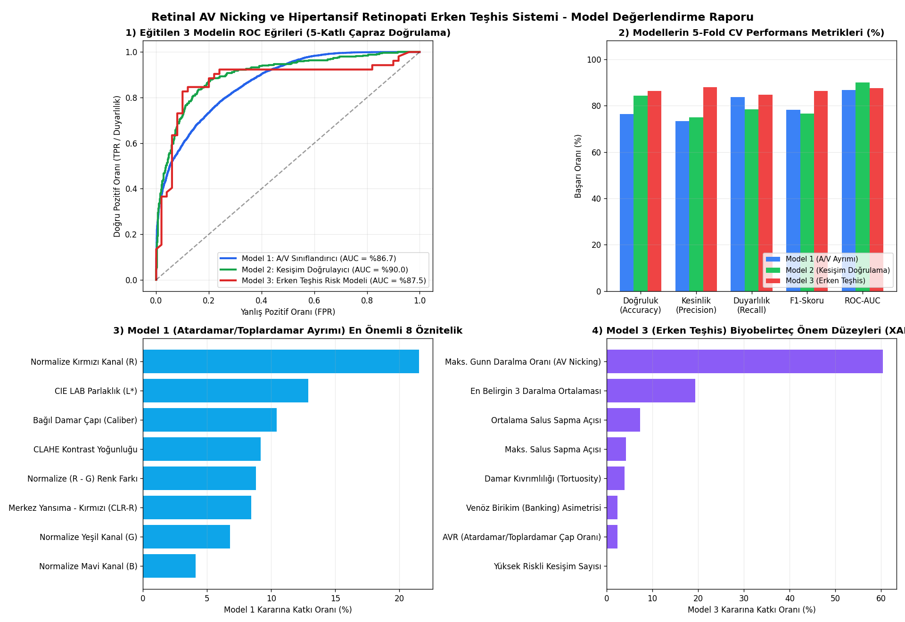

# Retinal AV Nicking & Early Hypertensive Retinopathy Detection System
### *Explainable Hybrid Computer Vision & Machine Learning Pipeline for Retinal Microvascular Analysis*

[](https://www.python.org/)
[](https://opencv.org/)
[](https://scikit-learn.org/)
[](https://streamlit.io/)
[-purple.svg)](https://figshare.com/articles/dataset/LES-AV_dataset/11857698)

An end-to-end **Explainable Hybrid Medical Imaging & Machine Learning System** for the automated detection, sub-pixel quantification, and clinical risk grading of **Arteriovenous (AV) Nicking** and **Early-Stage Hypertensive Retinopathy** from color retinal fundus photographs.

---

## 🔬 1. Clinical Background & Motivation (English)

**Arteriovenous (AV) Nicking** (*Gunn's sign*) is a hallmark microvascular abnormality of chronic systemic hypertension and arteriolosclerosis. Where a stiff, thickened retinal arteriole crosses over a compliant retinal venule within a shared adventitial sheath, the artery compresses the underlying vein—producing focal venular narrowing (tapering), upstream venous banking, and S-shaped angular deflection (*Salus's sign*). Early detection from routine, non-invasive fundus photography prevents severe downstream end-organ damage including **ischemic/hemorrhagic stroke, myocardial infarction, and branch retinal vein occlusion (BRVO)**.

### Key Algorithmic Contributions
1. **Multi-Scale Hybrid Vessel Segmentation:** Fuses 5-scale morphological **Black Top-Hat** filtering (`r = 3, 5, 8, 12, 16`) with multi-scale **Frangi Hessian tubeness** responses and **Dual-Threshold Hysteresis** to preserve pinched, low-contrast venules at crossover sites without fragmentation.
2. **Model 1 – Optical & Morphological Artery/Vein (A/V) Classification:** Extracts a 14-dimensional feature vector per vessel segment (illumination-corrected RGB, HSV, CIE LAB `L*a*b*`, relative caliber, and **Central Light Reflex [CLR]** profiles) to classify segments into Arteries and Veins via an `ExtraTreesClassifier`.
3. **Model 2 – True A/V Crossing vs. Bifurcation Validator:** Uses a 9-dimensional geometric and optical contrast vector (`RandomForestClassifier`) to distinguish true arteriovenous overlaps from single-vessel bifurcations.
4. **Sub-Pixel Orthogonal Cross-Sectional Width Profiling $W(d)$:** Eliminates binary intersection blob inflation by masking the crossing arterial corridor and casting perpendicular scanlines along the venular centerline to measure **Full-Width at Half-Maximum (FWHM)** sub-pixel caliber profiles.
5. **Model 3 – Multi-Biomarker Explainable Early Diagnosis (`GradientBoostingClassifier`):** Combines 4 clinical biomarker families extracted purely from the fundus image:
   - **Gunn's Sign (AV Nicking Index & Venous Banking Asymmetry)**
   - **Salus's Sign (S-Shaped Venular Deflection Angle at Crossings)**
   - **AVR (Arteriovenous Caliber Ratio – CRAE / CRVE)**
   - **Vascular Tortuosity (Geometric Arc-Chord Curvature Index)**

---

## 📊 2. Quantitative Benchmark Results (5-Fold Cross-Validation on LES-AV)

All three machine learning models were trained and evaluated using **5-Fold Stratified Cross-Validation** on the public **LES-AV** clinical dataset (*Orlando et al., MICCAI 2018* — 22 high-resolution `1620x1444` images, pixel-level expert Artery/Vein masks, 299 ground-truth A/V crossings, and clinical blood pressure records):

| Model | Task / Role | Evaluation Samples | Accuracy | Precision | Recall | F1-Score | ROC-AUC |
| :--- | :--- | :---: | :---: | :---: | :---: | :---: | :---: |
| **Model 1 (`ExtraTrees`)** | Artery vs. Vein (A/V) Segment Classification | 12,763 segments | **76.41%** | **73.41%** | **83.70%** | **78.22%** | **86.69%** |
| **Model 2 (`RandomForest`)** | True A/V Crossing vs. Bifurcation Validation | 1,032 junctions | **84.30%** | **75.00%** | **78.25%** | **76.59%** | **89.98%** |
| **Model 3 (`GradientBoosting`)** | Early Hypertensive Retinopathy Risk Grading | 102 regions | **86.27%** | **88.00%** | **84.62%** | **86.27%** | **87.50%** |



---

## 🗂️ 3. Repository Structure

```text
├── app.py                        # Interactive Streamlit Clinical Web Dashboard (Live Analysis & XAI)
├── main.py                       # Batch CLI Processing Pipeline & Visual Report Generator
├── requirements.txt              # Python Dependencies
├── src/
│   ├── av_nicking.py             # Core Hybrid Segmentation, Sub-Pixel Profiler & Biomarker Engine
│   └── train_eval.py             # 5-Fold CV Training & Evaluation Pipeline for Models 1, 2, and 3
├── models/
│   ├── av_classifier.pkl         # Trained Model 1 (Artery/Vein Classifier)
│   ├── crossing_validator.pkl    # Trained Model 2 (Crossing vs. Bifurcation Validator)
│   ├── early_diagnosis_model.pkl # Trained Model 3 (Early Diagnosis Risk Classifier)
│   └── evaluation_metrics.json   # 5-Fold Cross-Validation Metrics, ROC Curves & Feature Importances
├── sunum_test_goruntuleri/       # Ready-to-Use Raw Fundus Images & Ground-Truth Reference Pairs
└── results/                      # Generated Visual Reports & Model Evaluation Plots
```

---

## 🚀 4. Quick Start & Installation

### 1. Install Dependencies
```bash
pip install -r requirements.txt
```

### 2. Launch the Interactive Streamlit Web Application
```bash
streamlit run app.py
```

### 3. Run Batch CLI Analysis or Retrain Models
```bash
# Run batch analysis on all fundus images in data/
python main.py

# Re-run 5-Fold CV training and generate evaluation metrics
python -m src.train_eval
```

---

## 🇹🇷 Türkçe Proje Özeti

Bu proje, renkli göz dibi (retina fundus) fotoğraflarından dışarıdan hiçbir statik klinik veriye ihtiyaç duymadan **AV Nicking (Arteriovenöz Çentiklenme)** ve **Erken Evre Hipertansif Retinopati** tespiti yapan açıklanabilir hibrit bir karar destek sistemidir:
- **Görüntü İşleme Motoru (`src/av_nicking.py`):** Çok ölçekli Black Top-Hat + Frangi tübülerlik segmentasyonu, piksel-altı (sub-pixel) dikey kesit FWHM çap profili $W(d)$ ve 4 klinik biyobelirteç (**Gunn daralması, Salus sapma açısı, AVR çap oranı, damar kıvrımlılığı**) ölçümü yapar.
- **3 Aşamalı Makine Öğrenmesi (`src/train_eval.py`):** `LES-AV` veri seti üzerinde 5-Katlı Çapraz Doğrulama ile eğitilmiş Atardamar/Toplardamar ayrım modeli (**%86.7 AUC**), Kesişim doğrulama modeli (**%90.0 AUC**) ve Erken Teşhis Risk modeli (**%87.5 AUC**) içerir.
- **Canlı Doktor Arayüzü (`app.py`):** Streamlit tabanlı web arayüzü üzerinden tek tıkla fundus fotoğrafı yüklenerek 4'lü damar haritası, piksel-altı çap değişim grafikleri ve erken teşhis risk raporu üretilir.
